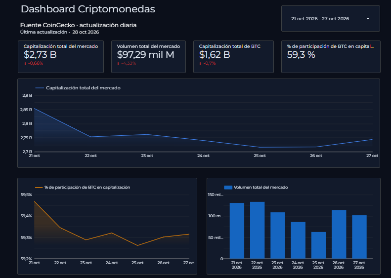
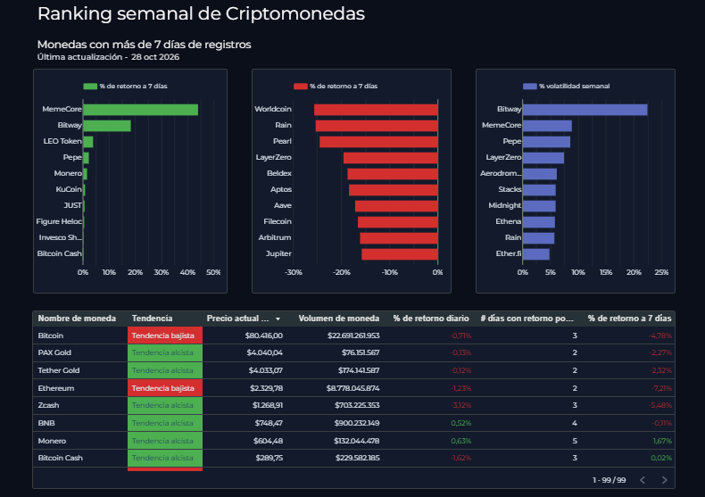
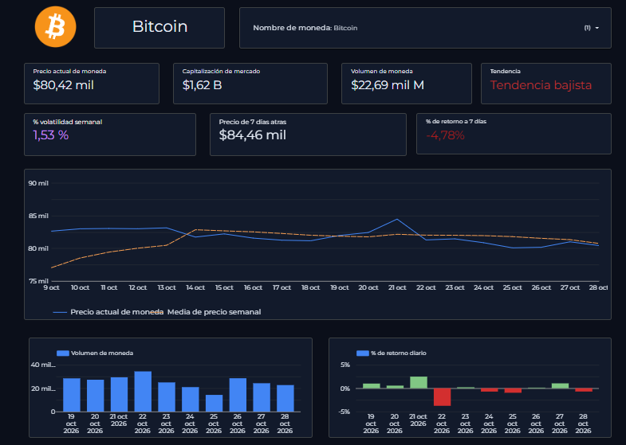

# Pipeline de analítica del mercado cripto

Pipeline de datos **end-to-end y automatizado** que extrae a diario el top 100 de criptomonedas por capitalización desde la API de CoinGecko, lo almacena en **Google Cloud Storage**, lo carga en **BigQuery**, se transforma con **dbt** (staging → intermediate → marts, con tests de calidad) y se visualiza en un dashboard de **Looker Studio** que se actualiza automáticamente.


---

## Dashboard

**[Visualización Dashboard](https://datastudio.google.com/reporting/f67b7312-eb6e-4b05-95c1-8d68db19d101)**

### Página 1: Visión general del mercad


KPIs del mercado total (market cap, volumen, dominancia de Bitcoin) con variación frente al día anterior y su evolución temporal.

### Página 2: Ranking semanal


Top monedas por retorno y volatilidad a 7 días, con tabla de rendimiento.

### Página 3: Detalle por moneda


Precio actual, tendencia (precio frente a media móvil de 7 días), retorno, volatilidad y volumen de la moneda seleccionada.

---

## Arquitectura


| Capa | Tecnología | Qué hace |
|---|---|---|
| Extracción | Python (`requests`) | Llama a `/coins/markets` (top 100 en USD) y guarda el JSON crudo. |
| Data lake | Google Cloud Storage | Guarda el JSON original (`raw/`) y el NDJSON enriquecido con `snapshot_date` (`staged/`), particionados por `year=/month=/day=`. |
| Raw | BigQuery (`crypto_raw`) | Tabla `market_snapshot` con el histórico de snapshots. |
| Transformación | dbt + BigQuery (`crypto_analytics`) | Modelos por capas, con tests de calidad. |
| Visualización | Looker Studio | Dashboard conectado a los marts. |
| Orquestación | GitHub Actions | Ejecuta extracción y `dbt build` de forma programada. |

---

## Modelado con dbt

```
staging/       stg_market_snapshot        (view)  limpieza, renombrado y deduplicación
intermediate/  int_daily_coin_return      (view)  variaciones diarias por moneda
marts/         fct_market_daily           (table) métricas del mercado por día
               fct_coin_performance_7d    (table) rendimiento de cada moneda a 7 días
```

**`stg_market_snapshot`**: renombra columnas y deja **una fila por `coin_id` + `snapshot_date`** (`QUALIFY ROW_NUMBER()`), quedándose con la actualización más reciente.

**`int_daily_coin_return`**: con `LAG()` sobre una ventana por moneda, calcula el cambio absoluto y porcentual de precio, volumen y market cap respecto al snapshot anterior.

**`fct_market_daily`**: un registro por día con:
- market cap y volumen totales y su variación diaria (absoluta y %)
- **dominancia de Bitcoin** dentro del top 100
- número de monedas del snapshot (`coins_day`)
- `is_latest_day` para filtrar el último snapshot en el dashboard

**`fct_coin_performance_7d`**: un registro por moneda y día con:
- retorno a 7 días (absoluto y %) y **ranking** del día por retorno
- **volatilidad**: desviación estándar del retorno diario en la ventana
- **media móvil de 7 días** del precio y bandera de tendencia (precio > MA7)
- días con retorno positivo en la ventana
- volumen medio de la semana actual frente a la anterior
- `days_in_window_7d` / `is_full_window` para saber si la ventana está completa
- `is_latest_day`

### Calidad de datos (tests)

- `not_null` en claves de staging y de la fuente.
- `dbt_utils.unique_combination_of_columns` en `coin_id + snapshot_date`.
- `dbt_utils.accepted_range` en métricas con dominio conocido (dominancia entre 0 y 1, días positivos entre 0 y 7, ranking ≥ 1, monedas por día entre 1 y 100).

Los tests se ejecutan en cada corrida con `dbt build`: si uno falla, el pipeline queda en rojo.

---

## Orquestación

El workflow [`.github/workflows/daily_snapshot.yml`](.github/workflows/daily_snapshot.yml):

1. Instala dependencias (Python 3.13).
2. Se autentica en GCP con una service account guardada como *secret*.
3. Ejecuta la extracción (`python -m ingestion.extract`).
4. Ejecuta `dbt deps` y `dbt build`.

Se dispara con `schedule` (cron en UTC) y también manualmente con `workflow_dispatch`.

---

## Decisiones técnicas

- **Carga idempotente**: antes de cargar, se borran de BigQuery las filas del mismo `snapshot_date` (`DELETE` parametrizado). Repetir una ejecución el mismo día no duplica datos.
- **Zona horaria explícita**: `snapshot_date` se calcula en `America/Bogota`. El cron de GitHub Actions corre en UTC, así que se programa en un minuto no exacto para evitar retrasos en horas punta, se ejecuta múltiples veces al día en caso de posibles fallos de ejecucición.
- **Views en staging e intermediate, tables en marts**: las capas intermedias no ocupan almacenamiento, y el dashboard consulta tablas ya calculadas.
- **Porcentajes como fracción** (0.05 = 5 %): el formato se aplica en Looker Studio, no en SQL.
- **Credenciales fuera del código**: `.env` local (cargado por `python-dotenv` y por dbt ≥ 1.12) y *secrets* en GitHub. El `profiles.yml` lee el keyfile con `env_var()`.

---

## Limitaciones conocidas

- Las ventanas de 7 días cuentan **filas**, no días de calendario: si falta un día, la ventana abarca más tiempo. `is_full_window` ayuda a detectarlo.
- La dominancia de Bitcoin se calcula sobre el **top 100**, no sobre el mercado total.
- El histórico empieza el día en que arrancó el pipeline (no hay backfill).
- GitHub desactiva los workflows programados tras **60 días sin actividad** en el repositorio.


---

## Autor

**Cristian Linero**  · [GitHub](https://github.com/cristianclc)

Datos proporcionados por [CoinGecko](https://www.coingecko.com/).
